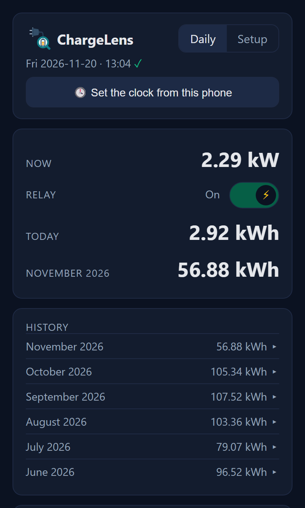

# ChargeLens

> [!CAUTION]
> **Use at your own risk, now and in every future version.** ChargeLens is provided "as is", without warranty of
> any kind, express or implied ([MIT License](LICENSE)). The author accepts no responsibility or liability, express
> or implied, for any damage, injury, fire, loss of data, wrong readings or wrong bills that may result from using
> the plug, the charger, the socket or this software. Charging a car draws high current for hours: check the
> ratings of everything involved and follow the charger and plug manufacturers' instructions. "Tested hardware"
> below lists the models ChargeLens was tested on; it is not a statement or guarantee that using them is safe.

> **Status: release candidate.** ChargeLens v1 is being validated (`v1.0.0-rc.N` tags); there is no final `v1.0.0`
> yet. Do not use it on a plug you rely on.

> [!WARNING]
> **No battery-backed clock.** Used offline (no home Wi-Fi), the plug loses the time at every power-up: moving it
> to another socket, unplugging it, a power cut. The LED ring turns **purple** or **orange** until you connect the
> phone to the plug's access point and press **Set the clock from this phone** on the daily page. Energy is kept
> meanwhile. Details: [docs/usage.md](docs/usage.md#the-clock-and-undated-charges).

Offline energy logger for charging an electric car from a socket someone else pays for (a condominium, an
employer, a landlord, family). ChargeLens runs as scripts on a **Shelly Plus Plug S**: it keeps daily and monthly
totals and charging sessions on the plug itself (no cloud, no hub, no internet needed, survives power cuts), shows
them on a phone page served by the plug, and prepares a monthly report by e-mail or CSV.

Example data: the numbers in the screenshots are random.

## Use cases

Anywhere you charge from a socket that someone else pays for, or where you want to know exactly what a charge
cost:

- **A shared garage or condominium**: report your monthly kWh to the administration or your neighbours.
- **A few days at a friend's or family member's house**: plug it in on arrival, and before you leave show them
  the total (or send the report) and pay for what you used.
- **A rented flat, a holiday rental or a second home**: settle with the landlord or the owner by the real
  consumption instead of a guess.
- **At work**: show the employer how much you charged, for reimbursement or for a benefit-in-kind calculation.
- **A guest charging at your place**: the reverse case; ask for the right amount.
- **A campsite or marina pitch** that bills electricity separately: know your car's share before the bill comes.
- **Your own car's real consumption**: kWh taken from the socket per charge (charger losses included), next to
  what the car reports.

The plug works without any network, so it suits places where you have no access to the owner's Wi-Fi.

## Why it exists

I charge my car from a shared socket and have to report, every month, how much energy I used so it can be billed
fairly. I could not find a ready-made solution that works offline, at a socket with no Wi-Fi, without a cloud
account or a home-automation hub. So I built one on a Shelly plug for my own use (a private build). It solved the
problem well, so I decided to share it: ChargeLens is that build, made configurable and documented for anyone.

## How it was built

The code was developed with [Claude](https://claude.com/claude-code) (Anthropic's AI coding assistant), under my
supervision: I specified it, reviewed the design decisions, and tested the private build in production on my own
car charging before publishing. Tests run on real devices and in a headless browser
([docs/development.md](docs/development.md)).

## Features

- Energy per day and month (6 months kept on the plug), charging sessions, relay/boot events.
- Status LED ring: idle, low current, charging, high current, clock unknown.
- Phone page from the plug's own Wi-Fi access point; relay toggle; setup page with export/import.
- Monthly report by e-mail (editable template) and CSV download.
- Install from the browser through the Shelly web UI "Library" (no PC needed), or manually.
- English UI. No cloud, no account, no hub.

## Tested hardware

ChargeLens was developed and tested on the Shelly **Plus Plug S** (Gen2) and the Shelly **Plug S Gen3**,
including rebranded variants that run Shelly firmware (e.g. EcoFlow x Shelly). The installer accepts only these
models. "Tested" means only that the software was tested on them; it is no warranty of any kind, in particular
not about safety (see the caution at the top). Other Shelly devices with metering may follow.

> **Charger requirement: stay below the plug's relay protection.** These plugs are rated 12 A / 2500 W. Limit your
> car or charger **below the relay protection values** of the plug (the installer and the setup page show them).
> Above them the plug's relay switches the power off by itself. A charger that draws more than the plug is rated
> for can also overheat the plug or the socket. The installer asks you to confirm it. See
> [docs/configuration.md](docs/configuration.md).

> **Use a plug dedicated to ChargeLens.** We recommend that the plug runs **no other scripts**. ChargeLens needs
> all 3 running script slots and most of the plug's small script memory (about 25 KB shared), and it was tested
> only on plugs without other scripts. Other scripts can make it run out of memory, miss readings or fail to
> start, and problems on such a plug cannot be reproduced or investigated. Details:
> [docs/how-it-works.md](docs/how-it-works.md).

## Quick start

Each guide below has numbered steps, one action per step.

1. Limit the charger below the plug's relay protection values (shown by the installer).
2. Prepare the plug (power, Wi-Fi, firmware): [docs/shelly-setup.md](docs/shelly-setup.md).
3. Install ChargeLens from the plug's web UI through the Shelly Library: [docs/install.md](docs/install.md) (or the
   [manual path](docs/install-manual.md)).
4. Set your thresholds, price and mail on the setup page: [docs/configuration.md](docs/configuration.md).
5. Use it: [docs/usage.md](docs/usage.md).

## Documentation

| Document | What |
|---|---|
| [docs/shelly-setup.md](docs/shelly-setup.md) | Unbox, Wi-Fi, firmware (stepwise updates), recommended settings |
| [docs/install.md](docs/install.md) | Install and update from the browser (Library URL) |
| [docs/install-manual.md](docs/install-manual.md) | Install by hand, script by script |
| [docs/configuration.md](docs/configuration.md) | Every setup field, choosing thresholds, mail placeholders |
| [docs/usage.md](docs/usage.md) | Daily routine, undated charges, monthly report |
| [docs/security.md](docs/security.md) | No device login: what that means and how to stay safe |
| [docs/troubleshooting.md](docs/troubleshooting.md) | Common problems |
| [docs/how-it-works.md](docs/how-it-works.md) | Scripts, key-value map, clock, limits |
| [docs/development.md](docs/development.md) | Build, tests, release checklist |
| [docs/manual-tests.md](docs/manual-tests.md) | Manual test checklist: install, setup page, daily page, update |
| [CHANGELOG.md](CHANGELOG.md) | Changes |

## Layout

| Path | What |
|---|---|
| `src/` | Script and page sources |
| `tests/` | Device tests and page tests |
| `tools/` | Build and dev CLI (Python stdlib only), privacy check |
| `dist/` | Committed build output (devices read it through raw.githubusercontent.com) |
| `library/` | Shelly Library URL manifest |
| `docs/` | User and developer docs; `docs/assets/` logo and screenshots; `docs/superpowers/` design and plans |

## License

MIT, see [LICENSE](LICENSE).
