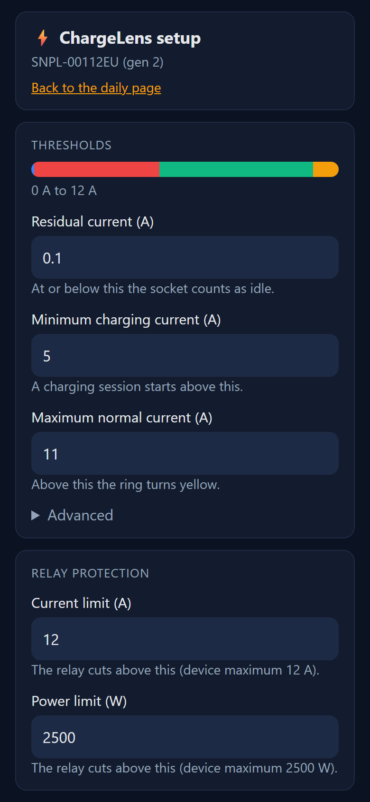
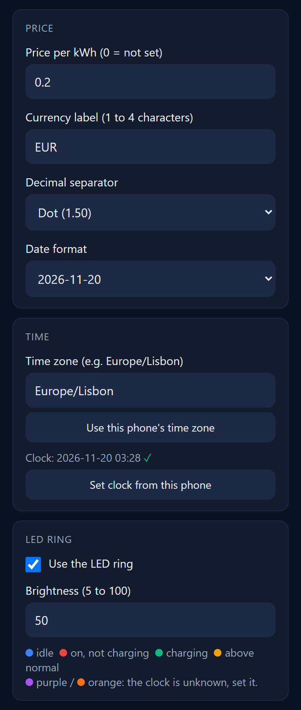
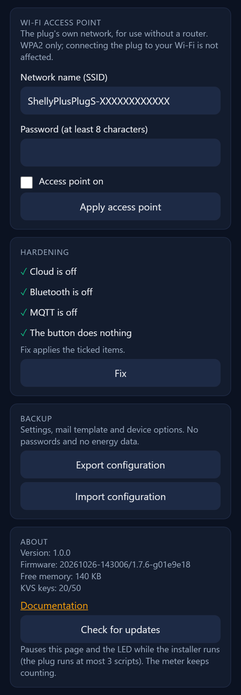

# Configuration

Everything is set on the plug's **setup page**: `http://<plug-ip>/script/<PageId>/ui?p=setup` (or **Setup** at the top
of the daily page). Changes are live within about a minute: the meter reads the settings once a minute.
Nothing on the setup page switches the relay.

> **Charger requirement.** The tested plugs are rated **12 A / 2500 W**. Limit the car or charger **below the
> plug's relay protection values** (the *Relay protection* card below, also shown by the installer). A charger that
> draws more than the plug is rated for can overheat the plug or the socket. The installer asks you to confirm
> "My charger is limited below these values". ChargeLens cannot limit the charger; the plug's relay only cuts the
> power off when its limits are exceeded.

 

Settings that are not saved (blank, damaged or hand-edited wrongly) fall back to their defaults field by field,
so a fresh install works before you open the setup page.

## Thresholds

The LED ring and the sessions use three current thresholds.

| Field | Default | Range | Meaning |
|---|---|---|---|
| Residual current (A) | 0.1 | 0.02 to 1 | At or below this the socket counts as idle (blue). |
| Minimum charging current (A) | 5 | 1 to 11 | At or above this a charging session starts (green). |
| Maximum normal current (A) | 11, or the proposal below | 1 to 12, below the relay current cut-off | Above this the ring turns yellow. |

**Proposal for the maximum.** When no maximum has been saved yet, the setup page proposes **90% of the relay
current cut-off** read from the plug (for example 12 A -> 10.8 A) and says "Proposal, not saved yet: the plug uses
11 A until you save." Until you press **Save** the plug keeps using its built-in 11 A. If you later lower the
cut-off in the plug settings, a saved maximum is **not** changed by itself; the setup page shows the error below
until you correct it. Set the maximum from your charger: a little above the current it draws, and below the
cut-off.

The order must be residual < minimum < maximum, and the maximum must be below the relay current cut-off (read from
the plug, see [Relay protection](#relay-protection)): if it is not, the field shows *Below the relay current
cut-off (12 A): lower it, or raise the cut-off in the plug settings* and **Save** is refused. Between the residual
and the minimum the ring is red (usually a charging error).

**Choosing values for your charger:** watch the charger's standby current (the plug's web UI shows the current in
amps) and its lowest charging current. Set *residual* just above the standby current, *minimum* a little below the
lowest charging current (many chargers start at 6 A), and *maximum* a little above the highest current you set. The
defaults suit a charger limited to about 10 A.

*Advanced* (collapsed on the page):

| Field | Default | Range | Meaning |
|---|---|---|---|
| Hysteresis (A) | 0.3 | 0.05 to 1 | Margin before the ring changes band at the minimum and maximum. |
| Residual hysteresis (A) | 0.05 | 0.01 to 0.5 | Same, at the residual threshold. |
| Band hold time (s) | 10 | 2 to 60 | A new band must hold this long before the ring changes. |
| Session gap (s) | 600 | 60 to 3600 | A session ends after this long without charging current. |

Changing a threshold or the session gap while a charge is running does not close the open session or touch the
relay; energy keeps counting.

## Relay protection

*Not on the Plug PM Gen3: it has no relay, so the setup page shows a "No cut-off" card there (the plug cannot cut the load; the only protection is the circuit breaker) and no Relay protection or Button settings.*

The plug's own relay protection, kept in the plug and **shown read-only** on the setup page:

| Shown | Meaning |
|---|---|
| Current cut-off (A) | The relay switches off above this current. |
| Power cut-off (W) | The relay switches off above this power. |
| Voltage cut-off (V) | The relay switches off above this voltage. |

A value the plug does not report shows as *unknown*; the other cards keep working.

> **Limit your charger below these values.** Above them the plug's relay switches the power off by itself, and it
> stays off until you switch it on again.

ChargeLens never writes these values: not from the setup page, not from the installer and not from an imported
configuration file (an exported file keeps them for information, and an import shows them as "shown only, not
applied"). To change them:

1. Press **Open the plug settings** on the Relay protection card. The Shelly web UI opens in a new tab, on
   *Output protections*.
2. Change the values there and save them.
3. Return to the setup page and reload it: the card shows the new values.

Notes:

- The plug rating is 12 A / 2500 W on both tested plugs, and the firmware refuses a current cut-off above 12 A or
  a power cut-off above 2500 W (checked on Plus Plug S firmware 1.7.6 and Plug S Gen3 firmware 2.2.0). A current
  cut-off of 0 A cuts at once; it does not turn the protection off. Sources:
  [Shelly Plus Plug S](https://www.shelly.com/blogs/documentation/shelly-plus-plug-s) (12 A) and
  [Shelly Plug S MTR Gen3](https://www.shelly.com/blogs/documentation/shelly-plug-s-mtr-gen3) (12 A, 2500 W for
  resistive loads).
- Example, not a rule: on the tested 12 A / 2500 W plugs the power cut-off is reached at about 10.4 to 10.9 A (on a
  240 to 230 V line), so 10 A is the largest common charger step that fits. On a charge of 10 A or more at a high
  line voltage the relay can cut at 2500 W before the ring ever turns yellow.
- ChargeLens logs every cut and the page shows "Cut by protection" (see [troubleshooting](troubleshooting.md)).
- These figures are the manufacturer's ratings, not a statement that charging a car through the plug is safe:
  see the caution in the [README](../README.md).

## Button

*Not on the Plug PM Gen3 (no relay, no button component).*

*Button does nothing* (default, `detached`) or *toggles the relay*. In the default mode only the page's relay
toggle switches the relay, and button presses leave no trace (the plug emits no event for them). In the toggle mode
the relay change is logged as an event with its source like any other.

## Price

- **Price per kWh**: 0 means not set; the page then shows kWh only and hides cost columns. Range 0 to 10.
- **Currency label**: 1 to 4 characters, any (`EUR`, `$`, `zl`, or a currency sign). It is stored as UTF-8 and
  counts toward the 253-byte settings limit.
- **Decimal separator**: `.` or `,`.
- **Date format**: year-month-day, day-month-year or month-day-year (display only; the CSV always uses ISO dates
  and `.` decimals).

There is one price, applied to everything shown.

## Time

- **Time zone** (e.g. `Europe/Berlin`): *Use this phone's time zone* fills it in.
- **Set the clock from this phone** is on the daily page and the setup page (the plug has no battery-backed clock;
  see [how-it-works.md](how-it-works.md)).

## LED ring

Use the ring on or off, and brightness 5 to 100. With the ring off, ChargeLens writes "off" to it once and then
leaves it alone. Colours: dark relay off; blue idle; green charging; yellow above the maximum; red anything else
while the relay is on. Purple (where blue, green or off would show) and orange (where red or yellow would show)
mean the clock is unknown. Table with what to do for each colour: [usage.md](usage.md#the-led-ring).

## Mail

Recipient (to, cc, bcc), subject and body of the monthly report, and the language of the month name. Placeholders:

| Placeholder | Replaced by |
|---|---|
| `{month_name}` | month name in the language set in **Language of {month_name}** (a tag such as `pt-PT` or `en-GB`), or in your phone's language when that field is empty |
| `{month}` | month number, `MM` |
| `{year}` | year |
| `{total_kwh}` | energy of the month |
| `{total_cost}` | cost, if a price is set |
| `{currency}` / `{price}` | the currency label / price per kWh |
| `{outside_kwh}` | energy outside charging sessions |
| `{session_count}` | number of sessions |
| `{sessions_table}` | plain-text table, one line per session (date, kWh, cost) |
| `{device_name}` | the device name |

Accents and currency signs work in the subject and body. The recipients and your signature stay on the plug and in
your own export file, never in this repository.

## Device and access point

Device name (up to 64 characters). Wi-Fi access point: network name, WPA2 password (at least 8 characters) and
on/off. If you are connected through the access point itself, applying a change disconnects you; reconnect to the
new network. See [security.md](security.md).

## Hardening

Shows whether the cloud, Bluetooth, MQTT and the websocket debug logs are on and whether the button toggles the
relay; *Fix* turns off the ticked items. Cloud off means no Shelly app access from outside the plug's networks.
The websocket debug logs are only needed to see script output in the console of the Shelly web UI; the
`Installer` script turns them on when it starts.

## Export and import

*Export configuration* downloads `chargelens-config-<device>-<date>.json` with the settings, the mail template and
the device options above. It has **no passwords** (the plug never returns them) and **no energy data**. It does
contain personal data (mail recipients), so keep it private. *Import configuration* checks the file (format version,
plug family, ranges), shows what will change, applies it, and never touches the energy log.
