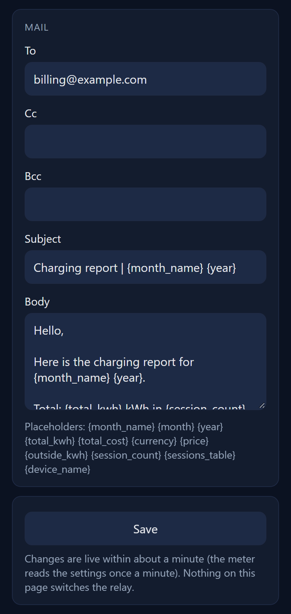

# Configuration

Everything is set on the plug's **setup page**: `http://<plug-ip>/script/<PageId>/ui?p=setup` (or **Setup** at the top
of the daily page). Changes are live within about a minute: the meter reads the settings once a minute.
Nothing on the setup page switches the relay.

> **Charger requirement.** The tested plugs are rated **12 A / 2500 W**. Set the car or charger to draw **at
> most 10 A**. A charger that draws more can overheat the plug or the socket. The installer asks you to confirm
> "My charger is set to draw at most 10 A". ChargeLens cannot limit the charger; the relay limits below only cut
> the plug off when they are exceeded.

 

Settings that are not saved (blank, damaged or hand-edited wrongly) fall back to their defaults field by field,
so a fresh install works before you open the setup page.

## Thresholds

The LED ring and the sessions use three current thresholds.

| Field | Default | Range | Meaning |
|---|---|---|---|
| Residual current (A) | 0.1 | 0.02 to 1 | At or below this the socket counts as idle (blue). |
| Minimum charging current (A) | 5 | 1 to 11 | At or above this a charging session starts (green). |
| Maximum normal current (A) | 11 | 1 to 12 | Above this the ring turns yellow. |

The order must be residual < minimum < maximum, and the maximum must be below the relay current limit. Between the
residual and the minimum the ring is red (usually a charging error).

**Choosing values for your charger:** watch the charger's standby current (the plug's web UI shows the current in
amps) and its lowest charging current. Set *residual* just above the standby current, *minimum* a little below the
lowest charging current (many chargers start at 6 A), and *maximum* a little above the highest current you set. The
defaults suit a charger limited to 10 A.

*Advanced* (collapsed on the page):

| Field | Default | Range | Meaning |
|---|---|---|---|
| Hysteresis (A) | 0.3 | 0.05 to 1 | Margin before the ring changes band at the minimum and maximum. |
| Residual hysteresis (A) | 0.05 | 0.01 to 0.5 | Same, at the residual threshold. |
| Band hold time (s) | 10 | 2 to 60 | A new band must hold this long before the ring changes. |
| Session gap (s) | 600 | 60 to 3600 | A session ends after this long without charging current. |

Changing a threshold or the session gap while a charge is running does not close the open session or touch the
relay; energy keeps counting.

## Relay protection

Device settings, kept in the plug itself:

- **Current limit (A)** and **Power limit (W)**: the relay cuts above them. The maximum normal current must stay
  below the current limit.
- **The plug rating is 12 A / 2500 W on both tested plugs.** ChargeLens does not read it from the plug (the
  firmware has no call that reports it); it is a fixed value per model in the setup page and the installer, taken
  from:
  - the manufacturer's data: [Shelly Plus Plug S](https://www.shelly.com/blogs/documentation/shelly-plus-plug-s)
    (12 A) and [Shelly Plug S MTR Gen3](https://www.shelly.com/blogs/documentation/shelly-plug-s-mtr-gen3) (12 A,
    2500 W for resistive loads);
  - the firmware itself, which refuses a current limit above 12 A or a power limit above 2500 W (checked on Plus
    Plug S firmware 1.7.6 and Plug S Gen3 firmware 2.2.0).
- The setup page refuses values above the rating and warns while you type when a value is below it: the relay
  then cuts earlier, and a power limit below about 2400 W can cut a 10 A charge.
- Note: 2500 W is about 10.9 A at 230 V, so the power limit can cut before the current limit and before the
  default 11 A maximum. A 10 A charger draws roughly 2300 to 2450 W.
- These figures are the manufacturer's ratings, not a statement that charging a car through the plug is safe:
  see the caution in the [README](../README.md).

## Button

*Button does nothing* (default, `detached`) or *toggles the relay*. In the default mode only the page's relay
toggle switches the relay, and button presses leave no trace (the plug emits no event for them). In the toggle mode
the relay change is logged as an event with its source like any other.

## Price

- **Price per kWh**: 0 means not set; the page then shows kWh only and hides cost columns. Range 0 to 10.
- **Currency label**: 1 to 4 characters, any (`EUR`, `$`, `zl`, or a currency sign). It is stored as UTF-8 and
  counts toward the 253-byte settings limit.
- **Decimal separator**: `.` or `,`.
- **Date format**: year-month-day, day-month-year or month-day-year (display only; the CSV always uses ISO dates
  and `.` decimals).

There is one price, applied to everything shown.

## Time

- **Time zone** (e.g. `Europe/Berlin`): *Use this phone's time zone* fills it in.
- **Set the clock from this phone** is on the daily page and the setup page (the plug has no battery-backed clock;
  see [how-it-works.md](how-it-works.md)).

## LED ring

Use the ring on or off, and brightness 5 to 100. With the ring off, ChargeLens writes "off" to it once and then
leaves it alone. Colours: dark relay off; blue idle; green charging; yellow above the maximum; red anything else
while the relay is on. Purple (where blue, green or off would show) and orange (where red or yellow would show)
mean the clock is unknown.

## Mail

Recipient (to, cc, bcc), subject and body of the monthly report. Placeholders:

| Placeholder | Replaced by |
|---|---|
| `{month_name}` | month name in your phone's language |
| `{month}` | month number, `MM` |
| `{year}` | year |
| `{total_kwh}` | energy of the month |
| `{total_cost}` | cost, if a price is set |
| `{currency}` / `{price}` | the currency label / price per kWh |
| `{outside_kwh}` | energy outside charging sessions |
| `{session_count}` | number of sessions |
| `{sessions_table}` | plain-text table, one line per session (date, kWh, cost) |
| `{device_name}` | the device name |

Accents and currency signs work in the subject and body. The recipients and your signature stay on the plug and in
your own export file, never in this repository.

## Device and access point

Device name (up to 64 characters). Wi-Fi access point: network name, WPA2 password (at least 8 characters) and
on/off. If you are connected through the access point itself, applying a change disconnects you; reconnect to the
new network. See [security.md](security.md).

## Hardening

Shows whether the cloud, Bluetooth, MQTT and the websocket debug logs are on and whether the button toggles the
relay; *Fix* turns off the ticked items. Cloud off means no Shelly app access from outside the plug's networks.
The websocket debug logs are only needed to see script output in the console of the Shelly web UI; the
`Installer` script turns them on when it starts.

## Export and import

*Export configuration* downloads `chargelens-config-<device>-<date>.json` with the settings, the mail template and
the device options above. It has **no passwords** (the plug never returns them) and **no energy data**. It does
contain personal data (mail recipients), so keep it private. *Import configuration* checks the file (format version,
plug family, ranges), shows what will change, applies it, and never touches the energy log.
