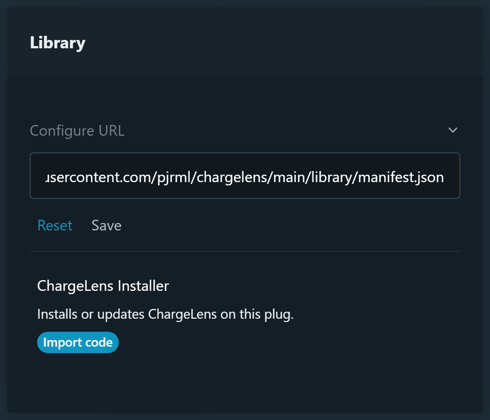
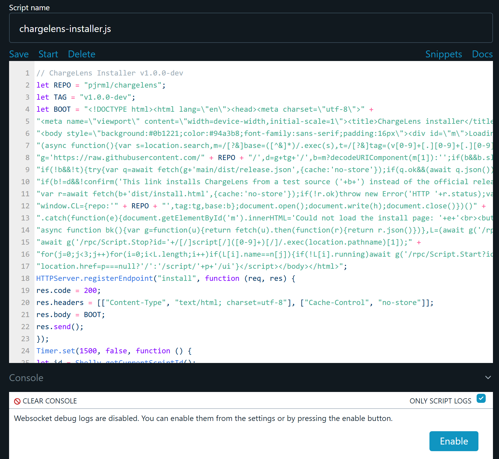
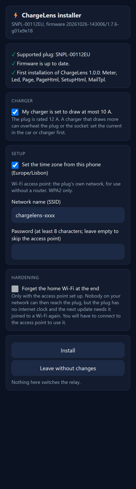

# Install ChargeLens (Library URL path)

This installs everything from your phone or computer, with no tools. If it fails, use the
[manual path](install-manual.md).

> **Status: release candidate.** ChargeLens v1 is being validated; there is no final `v1.0.0` yet. Do not use
> ChargeLens on a plug you rely on.

> [!CAUTION]
> **Use at your own risk.** ChargeLens comes without warranty of any kind and the author accepts no liability
> for its use or for the use of the plug, the charger or the socket. See the [README](../README.md).

> **Charger requirement.** The tested plugs are rated 12 A / 2500 W. Set the car or charger to draw **at most
> 10 A** before you start. The installer asks you to tick "My charger is set to draw at most 10 A"; a charger that
> draws more can overheat the plug or the socket.

## Before you start

> [!WARNING]
> **The plug has no battery-backed clock.** It knows the time only from the internet (while it is on a Wi-Fi with
> internet) or from your phone. Used offline, without the home Wi-Fi, **it loses the clock at every power-up**:
> when you move it to the charging socket, unplug it, or after a power cut. The LED ring then shows **purple**
> instead of blue, green or off, and **orange** instead of yellow or red. To set the clock:
>
> 1. Connect the phone to the plug's access point (its network name and address are in the *About* card at the
>    bottom of the daily page; note them while you are still on the home Wi-Fi).
> 2. Open the daily page.
> 3. Press **Set the clock from this phone**.
>
> Energy counted while the clock was unknown is not lost: it is dated automatically if you set the clock before
> the plug powers up again, and otherwise listed as **Undated** charges for you to date by hand. Details: [usage.md](usage.md#the-clock-and-undated-charges).

- A tested plug model (see [Tested hardware](../README.md#tested-hardware)) on up-to-date firmware, joined to a Wi-Fi network with internet: see
  [shelly-setup.md](shelly-setup.md).
- The plug's address (`<plug-ip>`) and a browser on the same network.
- Free script slots: the plug runs at most **3 scripts at once** and stores 10. ChargeLens uses 7 stored scripts
  and needs all 3 running slots. If other scripts of yours are running or enabled, the installer asks before it
  stops and disables them (it never deletes anything).

## Step 1: add the ChargeLens library

1. Open `http://<plug-ip>` in the browser.
2. Press **Scripts** in the menu.

   

3. Press **Library** (the list of ready-made scripts).
4. Press **Configure URL**.
5. Replace the URL with this one:

   ```
   https://raw.githubusercontent.com/pjrml/chargelens/main/library/manifest.json
   ```

6. Press **Save**. The list now shows **ChargeLens Installer**.
7. Press **Import code**.

   

The exact menu labels depend on the firmware version (these are from 1.7.x); look for "Library" on the Scripts
page. **Reset** in the same dialog brings back Shelly's own library.

## Step 2: save and start the installer script

**Import code** opens the script editor with the code and the name `chargelens-installer.js`. Do not change the
code.

1. Press **Save** (above the code). **Start** and **Delete** appear next to it.
2. Look at the *Console* below the code. If it says *Websocket debug logs are disabled*, press **Enable**.
   Without this the console stays empty and you do not see the address.

   

3. Press **Start**.
4. Wait a second or two. The console prints the address of the install page, like
   `http://<plug-ip>/script/<id>/install`. It prints it again after 3, 10 and 30 seconds.
5. Open that address in your browser and continue with Step 3.

> [!IMPORTANT]
> **The script renames itself to `Installer` when it starts.** The editor still shows the old name
> (`chargelens-installer.js`). That is expected; there is no need to press **Save** again. The *Scripts* list shows
> `Installer` after a reload.


If you pressed **Start** without **Enable**, the script turns the console logs on by itself, but the open page may
not notice. Then:

1. Reload the page in your browser.
2. Read the address in the console (it is printed again until 30 seconds after **Start**).
3. If the 30 seconds have passed, press **Stop**.
4. Press **Start**. The address is printed again.

Or type the address yourself: `http://<plug-ip>/script/<id>/install`, where `<id>` is the number shown as
`script:<id>` in the *Scripts* list (`1` on a new or freshly reset plug). If the plug refuses to start the script
("too many scripts"), stop another running script first.

## Step 3: use the install page

Open the address from the console in your browser. The browser (not the plug) downloads the installer page from
GitHub, so the browser needs internet. The page then runs these checks and screens:

| Screen | What it means |
|---|---|
| Tested model | The model is on the allow-list of tested models (Plus Plug S Gen2, Plug S Gen3, EcoFlow variant). Otherwise it stops. |
| Firmware | Must be up to date. If an update is offered, update first ([shelly-setup.md](shelly-setup.md)) and open the page again. |
| Charger | Tick the box to confirm the charger draws at most 10 A. |
| Other scripts | Lists scripts that must be stopped or disabled to fit the 3-script limit. Nothing is deleted. |
| Setup | Optional: time zone from this phone, the plug's access point (SSID and a WPA2 password of at least 8 characters). |
| Hardening | Cloud, Bluetooth and MQTT off, button does nothing, websocket debug logs off (all ticked by default; each says what you lose), and an optional "Forget the home Wi-Fi at the end (recommended)" (off by default). |
| Progress | Downloads each file, checks size and checksum, writes the scripts, reads them back, starts the meter and waits for the page. |

When it finishes it shows **Installed** with a link to the setup page and opens it a few seconds later; the
setup page links to the daily page. If you set an access point it also tells you how to reconnect: the plug's
network changes, so your phone may lose it.

Only the screens that apply are shown. In the example below Cloud, Bluetooth and MQTT were already off, so the
hardening screen only offers to forget the home Wi-Fi.

 

## Updating

1. Open the setup page: `http://<plug-ip>/script/<PageId>/ui?p=setup`.
2. Press **Check for updates** in *About*. It stops `Led` and `Page` (the plug cannot run four scripts) and opens
   the install page, which shows the new version and a link to what changed.
3. Press **Update**. When it finishes, the install page opens the daily page.

If the plug already has the newest version, the install page says *installed and up to date* and the button is
**Reinstall**: it writes the same version again (a repair), with the same safeguards as an update.

An update:

- is refused while the plug is charging or a session is open (it restarts the meter), and when the firmware is not
  up to date;
- keeps your settings, the mail template, the device settings and the whole energy log;
- never rewrites the `Installer` script itself (that only changes through the Library);
- turns the websocket debug logs off again at the end (the `Installer` script turns them on when it starts).

If you leave the page without installing, press **Leave without changes**: it restarts `Led` and `Page`.

If you start the `Installer` by hand in the Shelly web UI while ChargeLens is running, stop `Led` and `Page`
first (three scripts is the limit). A fresh install has no such issue.

## If something goes wrong

See [troubleshooting.md](troubleshooting.md). If the library does not load, use the
[manual path](install-manual.md).
