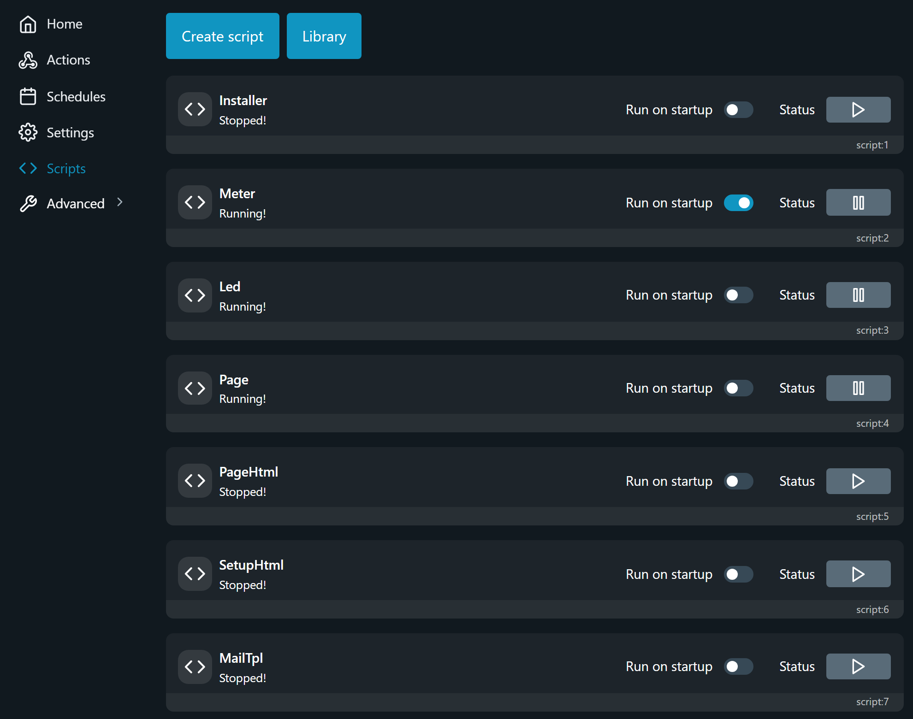
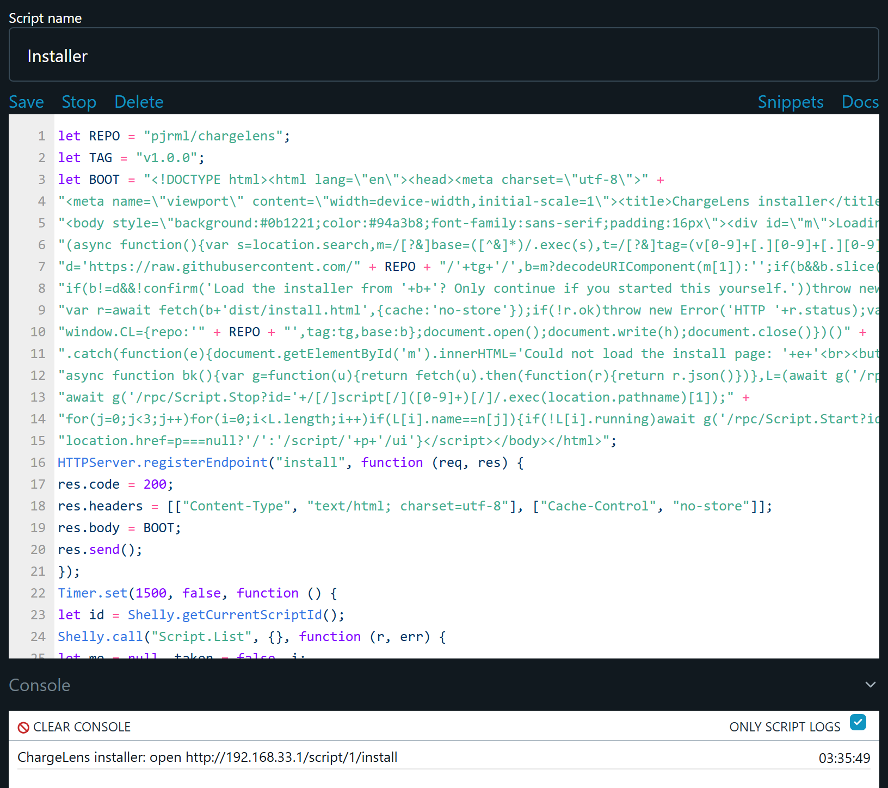
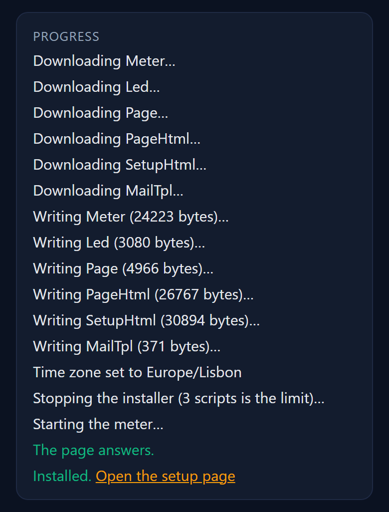

# Install ChargeLens (Library URL path)

This installs everything from your phone or computer, with no tools. If it fails, use the
[manual path](install-manual.md).

> **Status: in development.** There is no released version yet (no `v1.0.0` tag). The links below point at
> releases that do not exist yet. Do not use ChargeLens on a plug you rely on.

> **Charger requirement.** The supported plugs are rated 12 A / 2500 W. Set the car or charger to draw **at most
> 10 A** before you start. The installer asks you to tick "My charger is set to draw at most 10 A"; a charger that
> draws more can overheat the plug or the socket.

## Before you start

- A supported plug on up-to-date firmware, joined to a Wi-Fi network with internet: see
  [shelly-setup.md](shelly-setup.md).
- The plug's address (`<plug-ip>`) and a browser on the same network.
- Free script slots: the plug runs at most **3 scripts at once** and stores 10. ChargeLens uses 7 stored scripts
  and needs all 3 running slots. If other scripts of yours are running or enabled, the installer asks before it
  stops and disables them (it never deletes anything).

## Step 1: add the ChargeLens library

1. Open `http://<plug-ip>` -> **Scripts**.
2. Press **Library** (the list of ready-made scripts) and open **Configure URL**.

   

3. Replace the URL with this one and press **Save**:

   ```
   https://raw.githubusercontent.com/pjrml/chargelens/main/library/manifest.json
   ```

4. The list now shows **ChargeLens Installer**: press **Import code**. The plug creates the script.

   

   (The picture shows a plug where ChargeLens is already installed, so the script list behind the dialog is
   longer than yours.)

The exact menu labels depend on the firmware version (these are from 1.7.x); look for "Library" on the Scripts
page. **Reset** in the same dialog brings back Shelly's own library.

## Step 2: start the installer script

1. The new script renames itself to `Installer` a moment after it is created (reload the script list if it still
   shows a file name).
2. Open it and press **Start**. The script's console (below the code) prints the address of the install page,
   like `http://<plug-ip>/script/<id>/install`. If the console says *Websocket debug logs are disabled*, press
   **Enable** there and then **Stop** and **Start** the script again.

   

   You can also type the address yourself: the id is the number shown as `script:<id>` in the script list.

If the plug refuses to start it ("too many scripts"), stop another running script first.

## Step 3: use the install page

Open the address from the console in your browser. The browser (not the plug) downloads the installer page from
GitHub, so the browser needs internet. The page then runs these checks and screens:

| Screen | What it means |
|---|---|
| Supported plug | The model is on the allow-list (Plus Plug S Gen2, Plug S Gen3, EcoFlow variant). Otherwise it stops. |
| Firmware | Must be up to date. If an update is offered, update first ([shelly-setup.md](shelly-setup.md)) and open the page again. |
| Charger | Tick the box to confirm the charger draws at most 10 A. |
| Other scripts | Lists scripts that must be stopped or disabled to fit the 3-script limit. Nothing is deleted. |
| Setup | Optional: time zone from this phone, the plug's access point (SSID and a WPA2 password of at least 8 characters). |
| Hardening | Cloud, Bluetooth and MQTT off, button does nothing (all ticked by default; each says what you lose), and an optional "Forget the home Wi-Fi at the end" (off by default). |
| Progress | Downloads each file, checks size and checksum, writes the scripts, reads them back, starts the meter and waits for the page. |

When it finishes it shows **Installed** with a link to the setup page and opens it a few seconds later; the
setup page links to the daily page. If you set an access point it also tells you how to reconnect: the plug's
network changes, so your phone may lose it.

Only the screens that apply are shown. In the example below Cloud, Bluetooth and MQTT were already off, so the
hardening screen only offers to forget the home Wi-Fi.

 

## Updating

Open the setup page (`http://<plug-ip>/script/<PageId>/ui?p=setup`) and press **Check for updates** in *About*.
It stops `Led` and `Page` (the plug cannot run four scripts) and opens the install page, which shows the new
version and a link to what changed. An update:

- is refused while the plug is charging or a session is open (it restarts the meter), and when the firmware is not
  up to date;
- keeps your settings, the mail template, the device settings and the whole energy log;
- never rewrites the `Installer` script itself (that only changes through the Library).

If you leave the page without installing, press **Leave without changes**: it restarts `Led` and `Page`.

If you start the `Installer` by hand in the Shelly web UI while ChargeLens is running, stop `Led` and `Page`
first (three scripts is the limit). A fresh install has no such issue.

## If something goes wrong

See [troubleshooting.md](troubleshooting.md). If the library does not load, use the
[manual path](install-manual.md).
