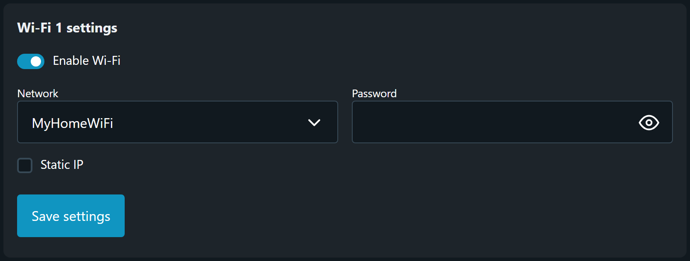
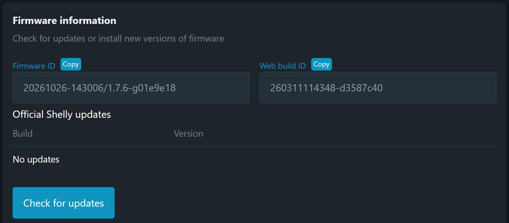

# Shelly setup

What to do with a new plug before installing ChargeLens. You need the plug, a phone or computer, and (once, for the
install) a Wi-Fi network with internet access.

> **Charger requirement.** The plug is rated 12 A / 2500 W. Set your car or charger to draw **at most 10 A**
> before you plug it in. A charger that draws more can overheat the plug or the socket. The installer asks you
> to confirm this.

Supported: Shelly **Plus Plug S** (Gen2, `SNPL-00112EU`) and Shelly **Plug S Gen3**, including rebranded variants
that run Shelly firmware (for example EcoFlow x Shelly, `EF3PL-00112EU`). Anything else is refused by the
installer.

## 1. Power it and join its own network

Menu names and labels vary by firmware version; the paths below are a guide.

1. Plug it into a mains socket. A new plug starts its own Wi-Fi access point (a name like `ShellyPlusPlugS-XXXXXX`
   or `ShellyPlugSG3-XXXXXX`), open, without a password.
2. Connect your phone or computer to that network and open `http://192.168.33.1`. This is the plug's web UI.

## 2. Join the plug to your Wi-Fi (once, for the install)

ChargeLens itself works offline, but the installer downloads the scripts from GitHub, so for the install your
browser needs internet, and so does the plug for firmware updates. Use a Wi-Fi network you control (your home
router, or a phone hotspot).

1. In the web UI: **Settings -> Wi-Fi** (under *Network settings*), turn on **Enable Wi-Fi** in *Wi-Fi 1
   settings*, pick your network, enter the password, **Save settings**.

   

2. The plug reconnects. Find its new address in your router's device list (or the Shelly app) and open
   `http://<plug-ip>`. From now on `<plug-ip>` means that address.

Your browser must be on the same network as the plug for the next steps.

## 3. Update the firmware (required)

The installer only continues when the firmware is **up to date**.

1. Web UI: **Settings -> Firmware** (or the Shelly app). Press **Check for updates**; if an update is offered
   under *Official Shelly updates*, install it. *No updates* means you are done.

   

2. Updates come **in steps**: after one update the next one is offered only after the plug has restarted. Update,
   wait for the restart (a few minutes), check again, and repeat until no update is offered.
3. Right after an update the plug may answer "Not committed" (error -109) if you start another update straight
   away. Wait about 7 minutes and try again.

The same rule applies to later ChargeLens updates: the installer refuses an update while the firmware is not up to
date.

## 4. Name and recommended settings

- **Name** (optional): Settings -> *Device settings* -> Device name. ChargeLens shows it in the mail template as `{device_name}`.
- **Time zone**: the setup page can fill it from your phone later.
- The installer offers to turn off the **Shelly cloud**, **Bluetooth** and **MQTT**, to make the **button** do
  nothing, and to configure the plug's own access point with a WPA2 password. You can do these in the installer or
  later on the setup page. See [security.md](security.md) for why.
- **Cloud off means no Shelly app access from outside the plug's networks.** You can still use the plug from a
  device on its Wi-Fi network or on its access point. If you want the Shelly app to reach the plug from anywhere,
  leave the cloud on and accept the risk (see security.md).

## 5. Continue

[Install ChargeLens](install.md) (from the browser, recommended) or [install it manually](install-manual.md).
