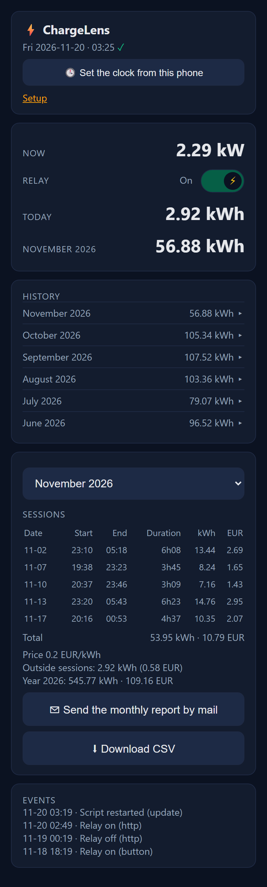

# Daily use

## The routine

1. Plug the ChargeLens plug into the socket.
2. Plug the charger's cable into the ChargeLens plug. The ring shows the state (see
   [configuration.md](configuration.md#led-ring)).
3. Start charging. The plug counts the energy; a session starts when the current is at or above the minimum
   charging current and ends when it has been below it for the session gap (10 minutes by default).

When you want the numbers:

1. Connect your phone to the plug's network (its access point, or the Wi-Fi it is on).
2. Open `http://<plug-ip>/script/<PageId>/ui`. With the access point the address is
   `http://192.168.33.1/script/<PageId>/ui`. The *About* card at the bottom of the daily page shows that address
   (and the access point's network name), so you can note it while the phone is still on the home Wi-Fi.

Once, on the phone, **add the page to the home screen** (share menu -> Add to Home Screen). It then opens like an
app, with the ChargeLens icon.

The plug keeps working with no phone connected and with no internet. Power cuts do not lose the totals.

## The daily page

- **Now** (current power), **Relay** (a switch with a lightning icon: yellow on, grey off, red when the plug cut
  itself off for overcurrent or overpower), **Today** and the **Month** total, in kWh and (with a price) in
  money.
- **History**: the months kept on the plug (six).
- **Sessions** of the chosen month, with start, duration, energy and cost.
- **Send the monthly report by mail** and **Download CSV** for the chosen month.
- **Events**: relay changes with their source, boots, script restarts (updates).
- **About**: the installed ChargeLens version, and the access point with the page address on it.
- **Daily** / **Setup** at the top switch between this page and the setup page.
- **Set the clock from this phone**.

_Example data (random numbers). The page shows the plug's own name, nothing personal._

Turning the relay off from the page asks for confirmation, because charging stops. Nothing else on any page
switches the relay.

## The clock and undated charges

> [!WARNING]
> **The plug has no battery-backed clock.** It knows the time only from the internet (while it is on a Wi-Fi with
> internet) or from your phone. Used offline, without the home Wi-Fi, **it loses the clock at every power-up**:
> when you move it to the charging socket, unplug it, or after a power cut. The LED ring then shows **purple**
> instead of blue, green or off, and **orange** instead of yellow or red. To set the clock:
>
> 1. Connect the phone to the plug's access point (its network name and address are in the *About* card at the
>    bottom of the daily page; note them while you are still on the home Wi-Fi).
> 2. Open the daily page.
> 3. Press **Set the clock from this phone**.
>
> Energy counted while the clock was unknown is not lost: it is dated automatically if you set the clock before
> the plug powers up again, and otherwise listed as **Undated** charges for you to date by hand.

The plug has no battery-backed clock. It gets the time from the internet (only when it is online) or from your
phone. Until the time is known the ring shows purple/orange. Energy used in that time is not lost: it is kept
against the plug's uptime and shown as **Undated** charges.

- If you set the clock (button on the page) in the same power-up, the charges are dated automatically.
- Otherwise they stay undated until you assign them in the **Undated** card:
  1. Tick the charge(s).
  2. Pick the day (the page offers the days between the last known date before and the next one).
  3. Press **Assign**.

To avoid undated charges, open the page after a power-up, before or during the first charge, and press *Set the
clock from this phone* (or leave the plug on a Wi-Fi with internet).

## The monthly report

1. Choose the month in the list.
2. Press **Send the monthly report by mail**. It opens your mail app with the template from the setup page (recipients,
   subject, body with the sessions table). If the report is too long for a mail link, the page copies the body to
   the clipboard and opens a short mail asking you to paste it.
3. Or press **Download CSV**. It saves a machine-friendly file (ISO dates, `.` decimals; types `day`, `month`, `session`,
   `event`) to attach or open in a spreadsheet.

## Travelling or unplugging

Unplug the plug and the charger as you like; the log stays on the plug. Without internet the clock is unknown
after every power-up (purple/orange ring): set it from your phone (see [The clock](#the-clock-and-undated-charges)). Do not update ChargeLens while a
charge is running; the installer refuses.
